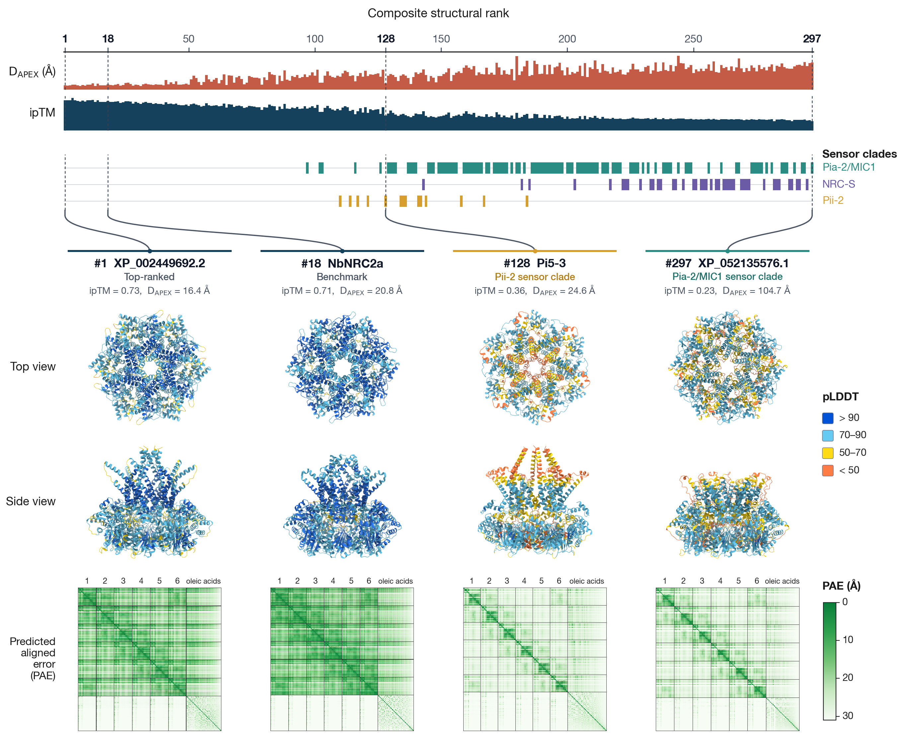

# Structural ranking of the candidates

This workflow turns the six structural metrics into the ranking reported in the
paper, and annotates each entry with its sensor clade and, where the receptor
was tested, the outcome of the functional screen.

## Inputs

- [`3.1_structural_scores.tsv`](../03_structural_metrics/data/results/3.1_structural_scores.tsv):
  the six metrics for the 296 candidates and the NbNRC2a benchmark.
- [`4.0_candidate_annotations.tsv`](data/inputs/4.0_candidate_annotations.tsv):
  for each entry, its assembly and protein accession, species, the modeled
  region, the submitted sequence, and the observations from the functional
  screen. `Cell_death`, `WT_domesticated_autoactivity` and `Codon optimization`
  are recorded for the 38 candidates tested *in planta* and are `N/A` for the
  rest. `screening_stage` indicates why each candidate was tested:
  `structural ranking` for the 34 chosen from the ranking reported here, and
  `SOLO1 clade follow-up` for the four SOLO1 homologs tested after the clade was
  identified, which are reported in Fig. 2B.
- [`4.0_sensor_clades/`](data/inputs/4.0_sensor_clades): the members of the
  Pii-2, NRC-S and Pia-2/MIC1 sensor clades (14, 42, and 109 accessions,
  respectively).
- [`4.4_chimerax_images/`](data/inputs/4.4_chimerax_images): ChimeraX top and
  side renders of the four representative hexamer predictions (ranks 1, 18, 128,
  and 297).

## Step 4.1: Rank the candidates and annotate them

### Purpose

Rank all 297 entries on each metric so that rank 1 is the most favorable value,
taking the direction of each metric into account: higher is better for
`ipTM_LCB`, `Sum_CONTACTS`, and `BSA_INT_PROTO`, whereas lower is better for
`D_APEX`, `SD_THETA_ROT`, and `S_PROTO`. Tied values share the average of the
ranks they span.

Order the entries using a weighted combination of two of those ranks,

```text
weighted_priority_score = 0.70 x ipTM_LCB rank + 0.30 x D_APEX rank
```

where a smaller score ranks higher. Entries that share a composite score are
ordered by ipTM, the more heavily weighted metric, with the identifier breaking
any remaining tie so that the order is reproducible. The other four ranks are
reported for comparison and take no part in the ordering.

Derive the screen outcome from the two recorded observations: a receptor whose
wild-type form is already autoactive is `Autoactive`, one that triggers cell
death only after the MHD-motif substitution is `DV-dependent cell death`, and
one that triggers no visible cell death is `No cell death`. Receptors that were
not part of this screen carry no observation and remain unannotated.

The script stops with an error unless the ranks run from 1 to 297 without gaps,
every shared composite score is resolved by ipTM rather than falling through to
the identifier, the clade lists are disjoint and all their members are present,
and the benchmark is the only reference entry.

### Script and command

```bash
python3 04_ranking/scripts/4.1_build_ranked_table.py \
  --scores 03_structural_metrics/data/results/3.1_structural_scores.tsv \
  --annotations 04_ranking/data/inputs/4.0_candidate_annotations.tsv \
  --clade-dir 04_ranking/data/inputs/4.0_sensor_clades \
  --output-tsv 04_ranking/data/results/4.1_ranked_scores.tsv
```

### Outputs

- [`4.1_ranked_scores.tsv`](data/results/4.1_ranked_scores.tsv): all 297 entries
  with their six favorable-direction ranks, the weighted ranking, the sensor
  clade, and the screen outcome, together with the two weights and the reference
  and clade-membership flags. The screen outcome covers the 38 tested
  candidates: 12 with DV-dependent cell death, 3 autoactive, and 23 without
  cell death. Table S1 is derived from this table.

## Step 4.2: Draw the structural ranking panel

### Purpose

Draw the structural ranking tracks of Fig. 1B. The entries are placed along the
top rank axis in the order of the weighted ranking, with the apex distance
(`#C45B47`) drawn above the interface confidence (`#15415C`). The members of each
sensor clade are marked in their own lane underneath, and dashed lines mark the
four representative entries shown in Fig. 1C at ranks 1, 18 (`NbNRC2a`), 128
and 297.

### Script and command

```bash
python3 04_ranking/scripts/4.2_plot_structural_ranking.py \
  --table 04_ranking/data/results/4.1_ranked_scores.tsv \
  --output-prefix 04_ranking/data/results/4.2_structural_ranking
```

### Outputs

- [`4.2_structural_ranking.pdf`](data/results/4.2_structural_ranking.pdf),
  [`.svg`](data/results/4.2_structural_ranking.svg) and
  [`.png`](data/results/4.2_structural_ranking.png): standalone ranking tracks.
  Text is kept as text in the vector formats.

## Step 4.3: Plot the predicted aligned error of representative hexamers

### Purpose

Four representative hexamer predictions spanning the structural ranking are
shown in Fig. 1C. This step draws the predicted aligned error (PAE) matrix of
each model from the deposited AlphaFold 3 `full_data` JSON outputs, marking
boundaries between protein chains (`1`–`6`) and the `oleic acids` membrane-proxy
block.

| Rank | Representative | Protein ID | Clade |
| --- | --- | --- | --- |
| 1 | Top-ranked | `XP_002449692.2` | — |
| 18 | Benchmark (`NbNRC2a`) | `NbNRC2a` | — |
| 128 | Pii-2 sensor clade (`Pi5-3`) | `XP_015612169.1` | Pii-2 |
| 297 | Pia-2/MIC1 sensor clade (lowest-ranked) | `XP_052135576.1` | Pia-2/MIC1 |

### Script and command

Run once per model, with `AF3_DIR` pointing at the extracted
`hexamer_models_rep1` directory from the Zenodo deposit
([doi:10.5281/zenodo.24540207](https://doi.org/10.5281/zenodo.24540207)):

```bash
python3 04_ranking/scripts/4.3_plot_af3_pae_multimer.py \
  "$AF3_DIR/gcf_000003195_3_6xxp_002449692_2_1_517/fold_gcf_000003195_3_6xxp_002449692_2_1_517_full_data_0.json" \
  --output-prefix 04_ranking/data/results/4.3_rank001_XP_002449692_pae \
  --dpi 200 --formats png
python3 04_ranking/scripts/4.3_plot_af3_pae_multimer.py \
  "$AF3_DIR/nbnrc2a_rep1/fold_nbnrc2a_rep1_full_data_0.json" \
  --output-prefix 04_ranking/data/results/4.3_rank018_NbNRC2a_pae \
  --dpi 200 --formats png
python3 04_ranking/scripts/4.3_plot_af3_pae_multimer.py \
  "$AF3_DIR/gcf_034140825_1_6xxp_015612169_1_1_447/fold_gcf_034140825_1_6xxp_015612169_1_1_447_full_data_0.json" \
  --output-prefix 04_ranking/data/results/4.3_rank128_Pi5-3_pae \
  --dpi 200 --formats png
python3 04_ranking/scripts/4.3_plot_af3_pae_multimer.py \
  "$AF3_DIR/gcf_000147395_1_6xxp_052135576_1_1_553/fold_gcf_000147395_1_6xxp_052135576_1_1_553_full_data_0.json" \
  --output-prefix 04_ranking/data/results/4.3_rank297_XP_052135576_pae \
  --dpi 200 --formats png
```

### Outputs

- [`4.3_rank001_XP_002449692_pae.png`](data/results/4.3_rank001_XP_002449692_pae.png),
  [`4.3_rank018_NbNRC2a_pae.png`](data/results/4.3_rank018_NbNRC2a_pae.png),
  [`4.3_rank128_Pi5-3_pae.png`](data/results/4.3_rank128_Pi5-3_pae.png) and
  [`4.3_rank297_XP_052135576_pae.png`](data/results/4.3_rank297_XP_052135576_pae.png).

## Step 4.4: Assemble Fig. 1B and Fig. 1C with representative structures and PAE matrices

### Purpose

Combine the structural ranking tracks (Fig. 1B; from Step 4.1) with the ChimeraX
top and side renders (plotted at an identical physical scale across all eight
renders) and the Step 4.3 PAE matrices with shared pLDDT and PAE color keys
(Fig. 1C) to assemble the combined Fig. 1B and Fig. 1C panel.

### Script and command

```bash
python3 04_ranking/scripts/4.4_plot_fig1b_with_structures.py \
  --table 04_ranking/data/results/4.1_ranked_scores.tsv \
  --chimerax-dir 04_ranking/data/inputs/4.4_chimerax_images \
  --pae-dir 04_ranking/data/results \
  --output-prefix 04_ranking/data/results/4.4_fig1b_structures
```

### Outputs

- [`4.4_fig1b_structures.pdf`](data/results/4.4_fig1b_structures.pdf),
  [`.svg`](data/results/4.4_fig1b_structures.svg) and
  [`.png`](data/results/4.4_fig1b_structures.png): the combined Fig. 1B and
  Fig. 1C panel. In the manuscript, this panel is placed below a schematic of
  the discovery workflow (Fig. 1A), which is not generated by these scripts.

<p></p>
