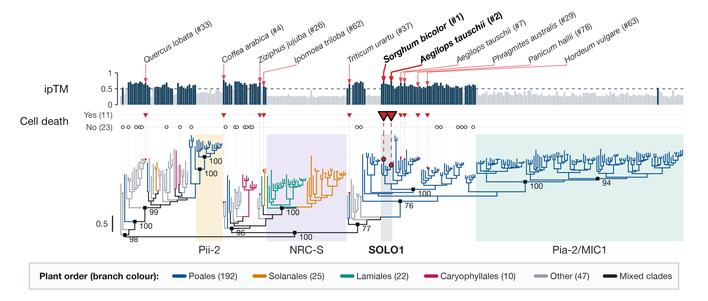
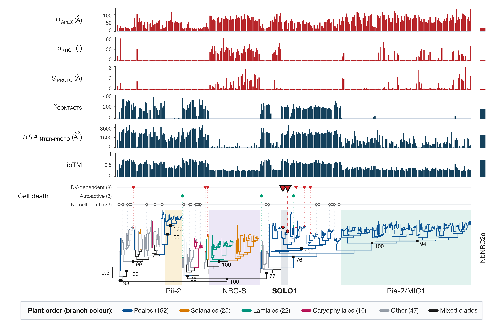

# Phylogeny of the modeled candidates

This workflow builds the NB-ARC phylogeny of the 296 candidates modeled with
AlphaFold 3, compiles the tip annotation table, and draws the annotated
phylogenies published as Fig. 2A and Fig. S2, as well as the six-receptor
SOLO1 cladogram shown in Fig. 2B.

## Inputs

- [`2.3_af3_targets.fasta`](../02_af3_modeling/data/results/2.3_af3_targets.fasta):
  the 296 modeled candidates, which define the taxon set.
- [`1.2_nlr_id_filtered_nbarc.fasta`](../01_nlr_id_dataset/data/results/1.2_nlr_id_filtered_nbarc.fasta):
  NB-ARC sequences of the discovery set.
- [`refseq_assemblies.tsv`](../01_nlr_id_dataset/data/inputs/refseq_assemblies.tsv):
  species names for the tip labels.
- [`4.1_ranked_scores.tsv`](../04_ranking/data/results/4.1_ranked_scores.tsv):
  scores, clade memberships, and screen outcomes shown as tracks.
- [`5.0_plant_order.tsv`](data/inputs/5.0_plant_order.tsv): taxonomic order for
  each of the 63 species represented among the modeled candidates. Orders follow
  [APG IV](https://doi.org/10.1111/boj.12385); the one gymnosperm,
  *Cryptomeria japonica*, is placed in Cupressales following
  [Christenhusz et al. (2011)](https://doi.org/10.11646/phytotaxa.19.1.3).
- [`7.0_solo1_clade_ids.txt`](../07_solo1_homologues/data/inputs/7.0_solo1_clade_ids.txt):
  list of SOLO1 clade accessions used to flag the SOLO1 clade tips on the
  candidate tree.

## Step 5.1: Collect the NB-ARC sequences

### Purpose

Take the NB-ARC sequence of each modeled candidate and relabel it as
`<species>|<assembly>|<protein>`.

### Script and command

```bash
python3 05_candidate_nbarc_tree/scripts/5.1_prepare_nbarc_alignment_input.py \
  --target-fasta 02_af3_modeling/data/results/2.3_af3_targets.fasta \
  --nbarc-fasta 01_nlr_id_dataset/data/results/1.2_nlr_id_filtered_nbarc.fasta \
  --assemblies-tsv 01_nlr_id_dataset/data/inputs/refseq_assemblies.tsv \
  --output-fasta 05_candidate_nbarc_tree/data/results/5.1_candidate_nbarc.fasta
```

### Outputs

- [`5.1_candidate_nbarc.fasta`](data/results/5.1_candidate_nbarc.fasta): 296
  NB-ARC sequences.

## Step 5.2: Align the NB-ARC sequences

Align with MAFFT (`--localpair --maxiterate 1000`) and write the alignment on
one line per sequence.

```bash
mafft --maxiterate 1000 --localpair \
  05_candidate_nbarc_tree/data/results/5.1_candidate_nbarc.fasta \
  | seqtk seq -l0 \
  > 05_candidate_nbarc_tree/data/results/5.2_candidate_nbarc.mafft.fasta
```

Output: [`5.2_candidate_nbarc.mafft.fasta`](data/results/5.2_candidate_nbarc.mafft.fasta).

## Step 5.3: Trim the alignment

Remove columns that are gaps in more than 90% of the sequences.

```bash
clipkit 05_candidate_nbarc_tree/data/results/5.2_candidate_nbarc.mafft.fasta \
  -m gappy -g 0.9 \
  -o 05_candidate_nbarc_tree/data/results/5.3_candidate_nbarc.mafft.clipkit.fasta
```

Output: [`5.3_candidate_nbarc.mafft.clipkit.fasta`](data/results/5.3_candidate_nbarc.mafft.clipkit.fasta).

## Step 5.4: Infer the maximum-likelihood tree

Let ModelFinder choose the substitution model and support the branches with
1,000 ultrafast bootstrap replicates.

```bash
iqtree -s 05_candidate_nbarc_tree/data/results/5.3_candidate_nbarc.mafft.clipkit.fasta \
  -pre 05_candidate_nbarc_tree/data/results/5.4_candidate_nbarc \
  -st AA -m MFP -bb 1000 -nt 8
```

The model selected by BIC is `Q.mammal+F+R7`.

### Outputs

- [`5.4_candidate_nbarc.treefile`](data/results/5.4_candidate_nbarc.treefile):
  the maximum-likelihood tree with ultrafast bootstrap support.
- [`5.4_candidate_nbarc.contree`](data/results/5.4_candidate_nbarc.contree):
  the bootstrap consensus tree.
- [`5.4_candidate_nbarc.iqtree`](data/results/5.4_candidate_nbarc.iqtree): the
  run report, including model selection.

## Step 5.5: Root the tree at its midpoint

### Purpose

Midpoint-root the maximum-likelihood tree with Biopython.

### Script and command

```bash
python3 05_candidate_nbarc_tree/scripts/5.5_midpoint_root_tree.py \
  --input-tree 05_candidate_nbarc_tree/data/results/5.4_candidate_nbarc.treefile \
  --output-tree 05_candidate_nbarc_tree/data/results/5.5_candidate_nbarc.midpoint_rooted.treefile
```

### Outputs

- [`5.5_candidate_nbarc.midpoint_rooted.treefile`](data/results/5.5_candidate_nbarc.midpoint_rooted.treefile):
  the tree displayed in Fig. 2A and the source of the six-receptor SOLO1
  cladogram in Fig. 2B.

## Step 5.6: Build the tip annotation table

### Purpose

Join the 296 tip labels of the midpoint-rooted tree with
[`4.1_ranked_scores.tsv`](../04_ranking/data/results/4.1_ranked_scores.tsv),
[`5.0_plant_order.tsv`](data/inputs/5.0_plant_order.tsv) and
[`7.0_solo1_clade_ids.txt`](../07_solo1_homologues/data/inputs/7.0_solo1_clade_ids.txt)
into a single plain tab-separated annotation table keyed on the tree tips.

Across the 296 tips, 165 belong to named sensor clades (109 Pia-2/MIC1,
42 NRC-S, and 14 Pii-2) and 6 belong to the SOLO1 clade. The tips span 21 plant
orders: Poales (192), Solanales (25), Lamiales (22), Caryophyllales (10), and
17 remaining orders grouped as Other (47). Of the 34 candidates selected from the
structural ranking, 11 triggered cell death and 23 did not; the four
additional SOLO1 homologs tested after the clade was identified are reported
in Fig. 2B and are distinguished by their `screening_stage` value.

### Script and command

```bash
python3 05_candidate_nbarc_tree/scripts/5.6_build_tip_annotations.py \
  --tree 05_candidate_nbarc_tree/data/results/5.5_candidate_nbarc.midpoint_rooted.treefile \
  --table 04_ranking/data/results/4.1_ranked_scores.tsv \
  --plant-order 05_candidate_nbarc_tree/data/inputs/5.0_plant_order.tsv \
  --solo1-ids 07_solo1_homologues/data/inputs/7.0_solo1_clade_ids.txt \
  --output-tsv 05_candidate_nbarc_tree/data/results/5.6_candidate_tip_annotations.tsv
```

### Outputs

- [`5.6_candidate_tip_annotations.tsv`](data/results/5.6_candidate_tip_annotations.tsv):
  unified tip annotation table for all 296 candidates (species, taxonomic plant
  order and top-4 grouping, sensor clade, SOLO1 clade flag, weighted rank,
  `ipTM_LCB`, `D_APEX`, and cell-death screening metadata).

## Step 5.7: Draw the candidate phylogeny

### Purpose

Draw Fig. 2A directly from the midpoint-rooted tree and the Step 5.6 tip
annotation table using R (`ggtree` and `patchwork`). Branches in the upward
phylogram (shown with exact Newick branch lengths and ultrafast bootstrap
support values) are colored by unanimous descendant plant order, with mixed
ancestral branches in dark gray and pastel background shading marking the
Pii-2, NRC-S, SOLO1, and Pia-2/MIC1 clades. Adjacent tracks show cell-death
markers for the 34 candidates chosen from the structural ranking (ranks 1 and 2
emphasized with larger black-rimmed markers) and the `ipTM_LCB` bar track split
at 0.5 (112 tips above 0.5 and 184 tips at or below 0.5), with callout labels
for the 11 cell-death hits.

### Script and command

```bash
Rscript 05_candidate_nbarc_tree/scripts/5.7_plot_candidate_phylogeny.R \
  --tree 05_candidate_nbarc_tree/data/results/5.5_candidate_nbarc.midpoint_rooted.treefile \
  --annotations 05_candidate_nbarc_tree/data/results/5.6_candidate_tip_annotations.tsv \
  --output-prefix 05_candidate_nbarc_tree/data/results/5.7_candidate_phylogeny
```

### Outputs

- [`5.7_candidate_phylogeny.pdf`](data/results/5.7_candidate_phylogeny.pdf),
  [`.svg`](data/results/5.7_candidate_phylogeny.svg) and
  [`.png`](data/results/5.7_candidate_phylogeny.png): the phylogeny panel
  published as Fig. 2A. Text is kept as text in the vector formats.

<p></p>

## Step 5.8: Draw the structural metrics across the phylogeny

### Purpose

Draw Fig. S2 directly from the midpoint-rooted tree, the Step 5.6 tip
annotation table, and [`4.1_ranked_scores.tsv`](../04_ranking/data/results/4.1_ranked_scores.tsv)
using R (`ggtree` and `patchwork`). The figure displays all six AlphaFold 3
structural metrics (`D_APEX`, `σ_θ ROT`, `S_PROTO`, `Σ_CONTACTS`, `BSA_INTER-PROTO`,
and `ipTM_LCB`) across the 296 modeled NLR-ID candidates alongside the `NbNRC2a`
benchmark column, aligned above the 3-class cell-death screening track
(`DV-dependent` (8), `Autoactive` (3), and `No cell death` (23)) and the
plant-order-colored NB-ARC phylogeny.

### Script and command

```bash
Rscript 05_candidate_nbarc_tree/scripts/5.8_plot_structural_metrics_phylogeny.R \
  --tree 05_candidate_nbarc_tree/data/results/5.5_candidate_nbarc.midpoint_rooted.treefile \
  --annotations 05_candidate_nbarc_tree/data/results/5.6_candidate_tip_annotations.tsv \
  --scores 04_ranking/data/results/4.1_ranked_scores.tsv \
  --output-prefix 05_candidate_nbarc_tree/data/results/5.8_structural_metrics_phylogeny
```

### Outputs

- [`5.8_structural_metrics_phylogeny.pdf`](data/results/5.8_structural_metrics_phylogeny.pdf),
  [`.svg`](data/results/5.8_structural_metrics_phylogeny.svg) and
  [`.png`](data/results/5.8_structural_metrics_phylogeny.png): the structural
  metrics and phylogeny figure published as Fig. S2. Text is kept as text in
  the vector formats.

<p></p>

## Fig. 2B: Six-receptor SOLO1 cladogram

The six-receptor phylogeny shown as a cladogram in Fig. 2B is the monophyletic
SOLO1 clade extracted from
[`5.5_candidate_nbarc.midpoint_rooted.treefile`](data/results/5.5_candidate_nbarc.midpoint_rooted.treefile)
(`SbSOLO1` [`XP_002449692.2`], `LpSOLO1` [`XP_051188689.1`], `HvSOLO1`
[`XP_044964102.1`], `TuSOLO1a` [`XP_048547975.1`], `AetSOLO1`
[`XP_020170543.1`], and `TuSOLO1b` [`XP_048559952.1`]). All five internal
branches have ultrafast bootstrap support >= 95: `100` (SOLO1 clade stem), `99`
(`SbSOLO1` + `LpSOLO1`), `100` (`HvSOLO1` + `TuSOLO1a` + `AetSOLO1` +
`TuSOLO1b`), `100` (`TuSOLO1a` + `AetSOLO1` + `TuSOLO1b`), and `100` (`AetSOLO1`
+ `TuSOLO1b`). Because Biopython's `root_at_midpoint()` in Step 5.5 shifts the
`(SbSOLO1, LpSOLO1)` support label (`99`) onto the clade stem and leaves the
`(SbSOLO1, LpSOLO1)` node unlabeled, exact bipartition support values are read
from the unrooted IQ-TREE output
[`5.4_candidate_nbarc.treefile`](data/results/5.4_candidate_nbarc.treefile)
(identical in
[`5.4_candidate_nbarc.contree`](data/results/5.4_candidate_nbarc.contree)).
