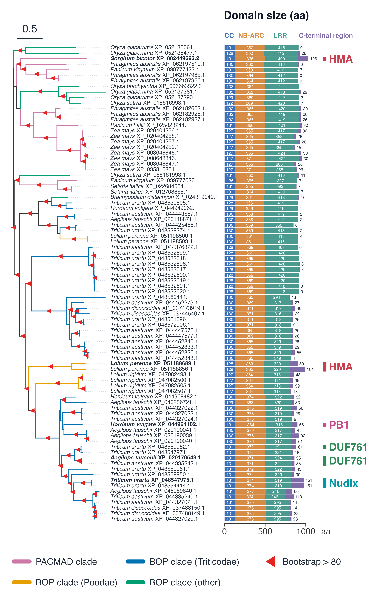
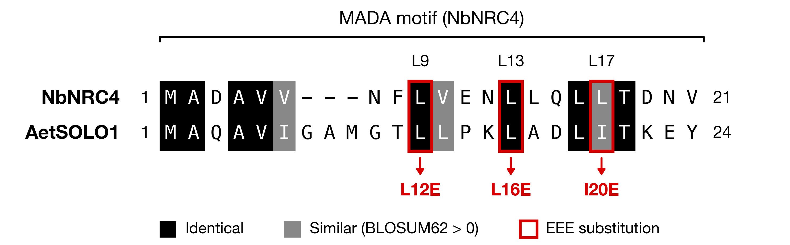

# SOLO1 homologs

This workflow characterizes the SOLO1 clade—identifying its members, inferring
their phylogeny, quantifying domain length variation, and aligning both full
sequences and the N-terminal MADA motif. It generates Fig. S5A, the predicted
aligned error plots of Fig. S5D, the color keys of Fig. S5B–D, the
alignment tracks of Fig. S6, and the MADA-motif alignment of Fig. S9A.

## Inputs

- [`7.0_solo1_clade_ids.txt`](data/inputs/7.0_solo1_clade_ids.txt): the 131
  curated RefSeq members extracted from the 136-sequence monophyletic SOLO1 clade
  on the plant-wide NLR tree of
  [`06_plant_nlr_nbarc_tree`](../06_plant_nlr_nbarc_tree), after excluding the
  RefPlantNLR entry `Yr-10` (initially reported as a CC-NLR candidate, *Yr10CG*,
  whereas true *Yr10* encodes the closely linked non-NLR *YrNAM*), two
  NB-ARC-only fragments (<300 aa), and two alternative splicing isoforms of the
  *Lolium perenne* locus `XP_051188856.1`. Together with Steps 7.2 and 7.3,
  filtering across the clade removes 1 RefPlantNLR entry, 37 splicing variants,
  and 12 sequences shorter than 800 aa, leaving 86 full-length sequences.
- [`7.0_seqid_to_assembly.tsv`](data/inputs/7.0_seqid_to_assembly.tsv): the
  assembly each sequence comes from.
- [`7.0_exon_boundaries.tsv`](data/inputs/7.0_exon_boundaries.tsv): exon
  boundaries of the clade members, taken from their RefSeq GFF3 annotations.
- [`7.0_nlrtracker_domains/`](data/inputs/7.0_nlrtracker_domains): the NLRtracker
  domain table for each clade member, one file per assembly, restricted to these
  proteins.
- [`7.0_af3_job_requests/`](data/inputs/7.0_af3_job_requests): the AlphaFold 3
  job requests for the five homologs modeled in Fig. S5B–D.
- [`7.0_chimerax_plddt_colours.txt`](data/inputs/7.0_chimerax_plddt_colours.txt):
  the ChimeraX commands that color the models by pLDDT in Fig. S5C.
- [`RefPlantNLR_NLR.fasta`](../06_plant_nlr_nbarc_tree/data/inputs/6.0_refplantnlr/RefPlantNLR_NLR.fasta):
  curated reference NLR set from [`06_plant_nlr_nbarc_tree`](../06_plant_nlr_nbarc_tree),
  providing `NbNRC4c` (`MK692737.1`) for Step 7.14.

Step 7.1 uses the full-length NLR set from
[`06_plant_nlr_nbarc_tree`](../06_plant_nlr_nbarc_tree), so run Step 6.1 first.

## Step 7.1: Extract SOLO1 clade sequences from the full-length NLR set

```bash
python3 07_solo1_homologues/scripts/7.1_extract_clade_sequences.py \
  --id-list 07_solo1_homologues/data/inputs/7.0_solo1_clade_ids.txt \
  --input-fasta 06_plant_nlr_nbarc_tree/data/results/6.1_selected_genomes_full_length_NLR.fasta \
  --output-fasta 07_solo1_homologues/data/results/7.1_solo1_clade_full_length.fasta
```

Output: [`7.1_solo1_clade_full_length.fasta`](data/results/7.1_solo1_clade_full_length.fasta), 131 sequences.

## Step 7.2: Remove identical splicing variants

### Purpose

RefSeq annotates several transcripts for some loci, which can yield identical
proteins. Within an assembly, group records that share an identical amino acid
sequence and whose genomic intervals overlap, and keep the record with the
lowest `XP_` accession number from each group.

### Script and command

```bash
python3 07_solo1_homologues/scripts/7.2_remove_identical_variants.py \
  --input-fasta 07_solo1_homologues/data/results/7.1_solo1_clade_full_length.fasta \
  --seqid-assembly-tsv 07_solo1_homologues/data/inputs/7.0_seqid_to_assembly.tsv \
  --exon-boundaries-tsv 07_solo1_homologues/data/inputs/7.0_exon_boundaries.tsv \
  --output-fasta 07_solo1_homologues/data/results/7.2_solo1_clade_nonredundant.fasta \
  --output-removed-tsv 07_solo1_homologues/data/results/7.2_removed_identical_variants.tsv \
  --output-kept-tsv 07_solo1_homologues/data/results/7.2_kept_records.tsv
```

### Outputs

- [`7.2_solo1_clade_nonredundant.fasta`](data/results/7.2_solo1_clade_nonredundant.fasta): 96 sequences; 35 records were removed.
- [`7.2_removed_identical_variants.tsv`](data/results/7.2_removed_identical_variants.tsv) and
  [`7.2_kept_records.tsv`](data/results/7.2_kept_records.tsv): what was removed and what was kept.

## Step 7.3: Filter out truncated sequences (< 800 aa)

```bash
python3 07_solo1_homologues/scripts/7.3_filter_by_min_length.py \
  --input-fasta 07_solo1_homologues/data/results/7.2_solo1_clade_nonredundant.fasta \
  --output-fasta 07_solo1_homologues/data/results/7.3_solo1_clade_min800.fasta \
  --report-tsv 07_solo1_homologues/data/results/7.3_length_filter_report.tsv \
  --min-length 800
```

Outputs: [`7.3_solo1_clade_min800.fasta`](data/results/7.3_solo1_clade_min800.fasta),
86 sequences; 10 were shorter than 800 residues, and
[`7.3_length_filter_report.tsv`](data/results/7.3_length_filter_report.tsv)
records the length and the decision for each of the 96 input sequences.

## Step 7.4: Align the full-length sequences

```bash
mafft --maxiterate 1000 --localpair \
  07_solo1_homologues/data/results/7.3_solo1_clade_min800.fasta \
  > 07_solo1_homologues/data/results/7.4_solo1_clade.mafft.fasta
```

Output: [`7.4_solo1_clade.mafft.fasta`](data/results/7.4_solo1_clade.mafft.fasta),
86 sequences in 1,447 alignment columns.

## Step 7.5: Trim the alignment

```bash
clipkit 07_solo1_homologues/data/results/7.4_solo1_clade.mafft.fasta \
  -m gappy -g 0.9 \
  -o 07_solo1_homologues/data/results/7.5_solo1_clade.mafft.clipkit.fasta
```

Output: [`7.5_solo1_clade.mafft.clipkit.fasta`](data/results/7.5_solo1_clade.mafft.clipkit.fasta),
86 sequences in 1,040 alignment columns; 407 columns with more than 90% gaps
were removed.

## Step 7.6: Infer the tree

```bash
iqtree -s 07_solo1_homologues/data/results/7.5_solo1_clade.mafft.clipkit.fasta \
  -pre 07_solo1_homologues/data/results/7.6_solo1_clade \
  -st AA -m MFP -bb 1000 -nt 8
```

The model selected by BIC is `Q.BIRD+F+R6`.

Outputs: [`7.6_solo1_clade.treefile`](data/results/7.6_solo1_clade.treefile) with
ultrafast bootstrap support, the consensus tree
[`7.6_solo1_clade.contree`](data/results/7.6_solo1_clade.contree) and the run
report [`7.6_solo1_clade.iqtree`](data/results/7.6_solo1_clade.iqtree).

## Step 7.7: Measure the domain lengths

### Purpose

Measure the CC, NB-ARC, and LRR domains of each homolog from its NLRtracker
annotation. In addition, measure the LRR region and the C-terminal region on
the untrimmed alignment
[`7.4_solo1_clade.mafft.fasta`](data/results/7.4_solo1_clade.mafft.fasta)
(1,447 columns), using the alignment columns carrying positions 510 and 833 of
the reference receptor `XP_020170543.1` as anchors: the alignment-based LRR
region is inclusive of columns 510–833 and the C-terminal region starts
exclusively after position 833 (`aln_seq[col_833 + 1 :]`). Both
`lrr_length_aa` (alignment-anchor) and `lrr_length_domain_aa` (NLRtracker) are
written to the summary table.

### Script and command

```bash
python3 07_solo1_homologues/scripts/7.7_build_domain_length_table.py \
  --target-fasta 07_solo1_homologues/data/results/7.3_solo1_clade_min800.fasta \
  --alignment-fasta 07_solo1_homologues/data/results/7.4_solo1_clade.mafft.fasta \
  --reference-seq-id Poales_Aegilops_tauschii_subsp._strangulata_XP_020170543.1_CNLO \
  --reference-lrr-start 510 --reference-lrr-end 833 \
  --seqid-assembly-tsv 07_solo1_homologues/data/inputs/7.0_seqid_to_assembly.tsv \
  --exon-boundaries-tsv 07_solo1_homologues/data/inputs/7.0_exon_boundaries.tsv \
  --nlrtracker-root 07_solo1_homologues/data/inputs/7.0_nlrtracker_domains \
  --output-table-tsv 07_solo1_homologues/data/results/7.7_domain_length_summary.tsv \
  --output-missing-tsv 07_solo1_homologues/data/results/7.7_domain_length_missing.tsv
```

### Outputs

- [`7.7_domain_length_summary.tsv`](data/results/7.7_domain_length_summary.tsv):
  domain and C-terminal length measurements per sequence, read by Step 7.11.
- [`7.7_domain_length_missing.tsv`](data/results/7.7_domain_length_missing.tsv):
  sequences whose domain lengths could not be measured; empty for this dataset.

## Step 7.8: Assign each homolog to a grass clade

### Purpose

Resolve the species of each sequence against the NCBI taxonomy and assign it to
`PACMAD` or to a `BOP` subgroup (`Triticodae`, `Poodae`, or `other BOP`), so
that the tree branches can be colored by grass lineage.

### Command

```bash
python3 07_solo1_homologues/scripts/7.8_make_itol_bop_pacmad.py \
  --input-fasta 07_solo1_homologues/data/results/7.3_solo1_clade_min800.fasta \
  --output-species-taxonomy-tsv 07_solo1_homologues/data/results/7.8_species_taxonomy_taxonkit.tsv \
  --output-seqid-clade-tsv 07_solo1_homologues/data/results/7.8_seqid_to_bop_pacmad.tsv \
  --output-missing-tsv 07_solo1_homologues/data/results/7.8_taxonkit_missing.tsv \
  --output-itol-colorstrip 07_solo1_homologues/data/results/7.8_itol_bop_pacmad.colorstrip.txt
```

The script queries the NCBI taxonomy through `taxonkit`, which requires the
taxonomy files installed locally. Pass `--auto-download-taxdump` to fetch them
into the directory given by `--taxonkit-data-dir`, or install them beforehand.
Its outputs are distributed here so that downstream steps run without `taxonkit`.

### Outputs

- [`7.8_itol_bop_pacmad.colorstrip.txt`](data/results/7.8_itol_bop_pacmad.colorstrip.txt):
  branch colors for Fig. S6 in iTOL.
- [`7.8_seqid_to_bop_pacmad.tsv`](data/results/7.8_seqid_to_bop_pacmad.tsv) and
  [`7.8_species_taxonomy_taxonkit.tsv`](data/results/7.8_species_taxonomy_taxonkit.tsv):
  clade assignments for each sequence (read by Step 7.11 for Fig. S5A) and the
  underlying NCBI taxonomy lineage.
- [`7.8_taxonkit_missing.tsv`](data/results/7.8_taxonkit_missing.tsv): sequences
  whose lineage could not be resolved; empty for this dataset.

## Step 7.9: Build the tip labels

```bash
python3 07_solo1_homologues/scripts/7.9_make_itol_labels.py \
  --input-fasta 07_solo1_homologues/data/results/7.3_solo1_clade_min800.fasta \
  --output-label-tsv 07_solo1_homologues/data/results/7.9_itol_labels.tsv \
  --output-itol-labels 07_solo1_homologues/data/results/7.9_itol_labels.txt
```

Outputs: [`7.9_itol_labels.txt`](data/results/7.9_itol_labels.txt), which
replaces each identifier with the species name and protein accession for Fig. S6
in iTOL, and [`7.9_itol_labels.tsv`](data/results/7.9_itol_labels.tsv), the
same 86 labels as a table read by Step 7.11 for Fig. S5A.

## Step 7.10: Build the alignment track

```bash
python3 07_solo1_homologues/scripts/7.10_make_itol_alignment.py \
  --input-alignment-fasta 07_solo1_homologues/data/results/7.5_solo1_clade.mafft.clipkit.fasta \
  --output-itol-alignment 07_solo1_homologues/data/results/7.10_itol_alignment.txt \
  --output-summary-tsv 07_solo1_homologues/data/results/7.10_itol_alignment_summary.tsv
```

Outputs: [`7.10_itol_alignment.txt`](data/results/7.10_itol_alignment.txt), the
alignment shown in Fig. S6, and
[`7.10_itol_alignment_summary.tsv`](data/results/7.10_itol_alignment_summary.tsv),
its record count and column count.

Fig. S6 is displayed in [iTOL](https://itol.embl.de) by uploading
[`7.6_solo1_clade.treefile`](data/results/7.6_solo1_clade.treefile) (midpoint-rooted),
[`7.9_itol_labels.txt`](data/results/7.9_itol_labels.txt),
[`7.8_itol_bop_pacmad.colorstrip.txt`](data/results/7.8_itol_bop_pacmad.colorstrip.txt)
and [`7.10_itol_alignment.txt`](data/results/7.10_itol_alignment.txt).

## Step 7.11: Plot the SOLO1 clade phylogeny and domain lengths

### Purpose

Draw Fig. S5A directly with R, `ggtree` and `patchwork` from
[`7.6_solo1_clade.treefile`](data/results/7.6_solo1_clade.treefile),
[`7.7_domain_length_summary.tsv`](data/results/7.7_domain_length_summary.tsv),
[`7.8_seqid_to_bop_pacmad.tsv`](data/results/7.8_seqid_to_bop_pacmad.tsv) and
[`7.9_itol_labels.tsv`](data/results/7.9_itol_labels.tsv).

All 86 sequences in `7.6_solo1_clade.treefile` are Poaceae SOLO1 homologs
with no outgroup, and neither PACMAD nor BOP forms a monophyletic bipartition
on the unrooted tree, so the tree is midpoint-rooted at the half-distance of the
longest tip-to-tip path (`3.58331` substitutions/site) before ladderizing with
`right = TRUE`, matching the midpoint rooting rule of Step 5.5 and placing the
five homologs modeled in Fig. S5B–D in monotonic top-to-bottom order.

### Script and command

```bash
Rscript 07_solo1_homologues/scripts/7.11_plot_solo1_phylogeny.R \
  --tree 07_solo1_homologues/data/results/7.6_solo1_clade.treefile \
  --domains 07_solo1_homologues/data/results/7.7_domain_length_summary.tsv \
  --clades 07_solo1_homologues/data/results/7.8_seqid_to_bop_pacmad.tsv \
  --labels 07_solo1_homologues/data/results/7.9_itol_labels.tsv \
  --output-prefix 07_solo1_homologues/data/results/7.11_solo1_phylogeny \
  --lrr-source anchor \
  --font-family Helvetica
```

`--lrr-source` selects whether the LRR bar plots the alignment-anchor value
(`anchor`, `lrr_length_aa`, default) or the NLRtracker domain length
(`nlrtracker`, `lrr_length_domain_aa`). `--font-family` sets the sans-serif
font explicitly across all text elements and output devices, and
`--show-model-connectors` (`FALSE` by default; `TRUE` to draw dashed
connectors) toggles connectors for the five homologs modeled in Fig. S5B–D.

### Outputs

- [`7.11_solo1_phylogeny.pdf`](data/results/7.11_solo1_phylogeny.pdf),
  [`7.11_solo1_phylogeny.svg`](data/results/7.11_solo1_phylogeny.svg) and
  [`7.11_solo1_phylogeny.png`](data/results/7.11_solo1_phylogeny.png): Fig. S5A
  with grass-lineage branch colors, ultrafast bootstrap triangles (> 80),
  stacked CC, NB-ARC, LRR and C-terminal length bars, printed C-terminal
  lengths, and integrated-domain bars (HMA, PB1, DUF761, Nudix).
- [`7.11_solo1_phylogeny_plotted_values.tsv`](data/results/7.11_solo1_phylogeny_plotted_values.tsv):
  deterministic table of all plotted values sorted by `seq_id`.

<p></p>

## Step 7.12: Plot the predicted aligned error of the modeled homologs

### Purpose

Five representative homologs, carrying HMA, PB1, Nudix, or DUF761 integrated
domains, were modeled as full-length monomers with AlphaFold 3 and are shown
in Fig. S5B–D. This step draws the predicted aligned error (PAE) matrix of each
model as a heatmap with a horizontal color bar from 0 to 31 Å (chain-boundary
lines are drawn automatically when multi-chain inputs are supplied).

The job requests that produced the models are included here. The AlphaFold 3
outputs themselves, including the `full_data` JSON files read by this step, are
too large to distribute through GitHub and are deposited at Zenodo,
[doi:10.5281/zenodo.24540207](https://doi.org/10.5281/zenodo.24540207)
(`solo1_monomer_models.tar.gz`).

| Job request | Protein | Integrated domain |
| --- | --- | --- |
| `fold_sb_snlr_id_hma` | XP_002449692.2 | HMA |
| `fold_lp_snlr_id_hma` | XP_051188689.1 | HMA |
| `fold_hv_snlr_id_pb1` | XP_044964102.1 | PB1 |
| `fold_at_snlr_id_duf761` | XP_020170543.1 | DUF761 |
| `fold_tu_snlr_id_nudix` | XP_048547975.1 | Nudix |

### Script and command

Run once per model, with `AF3_DIR` pointing at the extracted
`solo1_monomer_models` directory from the Zenodo deposit
([doi:10.5281/zenodo.24540207](https://doi.org/10.5281/zenodo.24540207)):

```bash
for name in sb_snlr_id_hma lp_snlr_id_hma hv_snlr_id_pb1 \
            at_snlr_id_duf761 tu_snlr_id_nudix; do
  python3 07_solo1_homologues/scripts/7.12_plot_af3_pae.py \
    "$AF3_DIR/$name/fold_${name}_full_data_0.json" \
    --output-prefix "07_solo1_homologues/data/results/7.12_${name}_pae" \
    --dpi 150 --formats png
done
```

`--vmax` sets the top of the color scale and defaults to 31; `--formats` accepts
any combination of `png`, `pdf`, and `svg`.

### Outputs

- [`7.12_sb_snlr_id_hma_pae.png`](data/results/7.12_sb_snlr_id_hma_pae.png):
  XP_002449692.2, 1,033 residues.
- [`7.12_lp_snlr_id_hma_pae.png`](data/results/7.12_lp_snlr_id_hma_pae.png):
  XP_051188689.1, 905 residues.
- [`7.12_hv_snlr_id_pb1_pae.png`](data/results/7.12_hv_snlr_id_pb1_pae.png):
  XP_044964102.1, 904 residues.
- [`7.12_at_snlr_id_duf761_pae.png`](data/results/7.12_at_snlr_id_duf761_pae.png):
  XP_020170543.1, 868 residues.
- [`7.12_tu_snlr_id_nudix_pae.png`](data/results/7.12_tu_snlr_id_nudix_pae.png):
  XP_048547975.1, 981 residues.

## Step 7.13: Draw the color bars of the structure panels

### Purpose

Fig. S5B–D combines structure renderings that carry no built-in color keys.
This step writes those three color keys as vector SVG files: the
sequence-position ramp of Fig. S5B, the pLDDT bands of Fig. S5C, and the PAE
scale of Fig. S5D.

The pLDDT bands match the thresholds and colors applied in ChimeraX, which are
recorded in
[`7.0_chimerax_plddt_colours.txt`](data/inputs/7.0_chimerax_plddt_colours.txt).
The PAE scale matches the palette, range, and ticks used in Step 7.12. Each
key is written in two label themes: `white` for dark backgrounds and `dark` for
white backgrounds.

### Script and command

```bash
python3 07_solo1_homologues/scripts/7.13_make_colorbars.py \
  --output-dir 07_solo1_homologues/data/results/7.13_colorbars
```

### Outputs

- `7.13_colorbars/colorbar_S5B_sequence_{white,dark}.svg`: the N-to-C
  sequence-position ramp of Fig. S5B.
- `7.13_colorbars/colorbar_S5C_plddt_{white,dark}.svg`: the four pLDDT bands of
  Fig. S5C.
- `7.13_colorbars/colorbar_S5D_pae_{white,dark}.svg`: the 0 to 31 Å PAE scale
  of Fig. S5D.

The script writes plain SVG directly using only the Python standard library. To
convert a key to PDF for figure assembly, run
`rsvg-convert -f pdf -o <name>.pdf <name>.svg`.

## Step 7.14: Align NbNRC4 and AetSOLO1 across the MADA motif

### Purpose

Align full-length `NbNRC4c` (`MK692737.1`, `RefPlantNLR`) and `AetSOLO1`
(`XP_020170543.1`, Step 7.1) with MAFFT L-INS-i (`--localpair --maxiterate 1000`)
and draw the N-terminal MADA-motif region (NbNRC4 residues 1–21; AetSOLO1
residues 1–24) for Fig. S9A. Identical residues are shaded in black and similar
residues (`BLOSUM62 > 0`) in gray, with red frames marking the three hydrophobic
positions (`L9`/`L12`, `L13`/`L16` and `L17`/`I20`) substituted with glutamate
in the `SOLO1^EEE` variants (`L12E`, `L16E` and `I20E`).

### Script and command

```bash
python3 07_solo1_homologues/scripts/7.14_plot_mada_alignment.py \
  --refplantnlr 06_plant_nlr_nbarc_tree/data/inputs/6.0_refplantnlr/RefPlantNLR_NLR.fasta \
  --solo1-fasta 07_solo1_homologues/data/results/7.1_solo1_clade_full_length.fasta \
  --output-alignment 07_solo1_homologues/data/results/7.14_nrc4c_aetsolo1.mafft_linsi.fasta \
  --output-prefix 07_solo1_homologues/data/results/7.14_mada_alignment
```

### Outputs

- [`7.14_nrc4c_aetsolo1.mafft_linsi.fasta`](data/results/7.14_nrc4c_aetsolo1.mafft_linsi.fasta):
  full-length MAFFT L-INS-i alignment of `NbNRC4c` and `AetSOLO1`.
- [`7.14_mada_alignment.pdf`](data/results/7.14_mada_alignment.pdf),
  [`.svg`](data/results/7.14_mada_alignment.svg) and
  [`.png`](data/results/7.14_mada_alignment.png): the Fig. S9A alignment panel.
  Text is kept as text in the vector formats.

<p></p>
