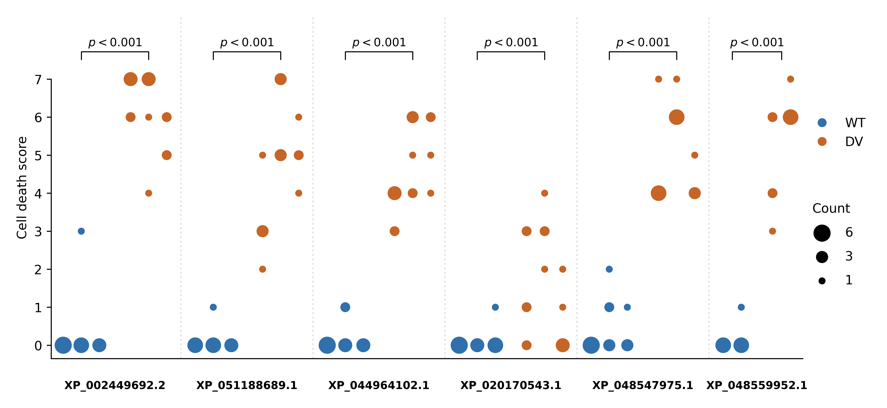
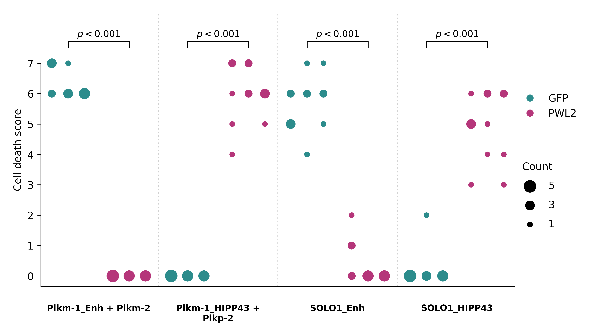

# Cell death assays

This workflow contains the cell-death scores from the transient expression
assays and the statistical tests comparing conditions within each assay. It forms
the basis of Fig. 3B, Fig. S7, and Tables S2–S5 of the manuscript.

The two assays are stored separately. The first compares each wild-type receptor
with its MHD-motif aspartate-to-valine (DV) variant. The second compares each
engineered receptor (or engineered Pik receptor pair) coexpressed with its
matched ligand against the same receptor coexpressed with the mismatched ligand.

## Inputs

- [`8.0_wt_vs_dv_scores.tsv`](data/inputs/8.0_wt_vs_dv_scores.tsv): 180 scores
  across six SOLO1 homologs, each tested as wild type (WT) and as its DV
  variant over five experiment dates.
- [`8.0_gfp_vs_pwl2_scores.tsv`](data/inputs/8.0_gfp_vs_pwl2_scores.tsv): 104
  scores across four engineered receptor systems (two engineered SOLO1
  receptors, `SOLO1_Enh` and `SOLO1_HIPP43`, and two engineered Pik receptor
  pairs, `Pikm-1_Enh + Pikm-2` and `Pikm-1_HIPP43 + Pikp-2`), each coexpressed
  with GFP and with PWL2 over three experiment dates.

Both files are in long format, one observation per row, with the columns
`Comparison`, `NLR`, `Experimental_Condition`, `Experiment_Date`, and
`Cell death score`. `8.0_wt_vs_dv_scores.tsv` includes an additional column,
`Receptor_name`, holding the name under which each homolog appears in the
figures; it is optional, and Step 8.1 copies it to the output when present.
Dates are written as `YYYY-MM-DD`. Cell death was scored visually on a 0 to 7
scale, where 0 indicates no visible symptoms and 7 indicates confluent necrosis
across the infiltrated area.

## Step 8.1: Compare the two conditions of each assay

### Purpose

Each receptor (or receptor pair) is tested independently. The two conditions are
compared using a two-sided Mann–Whitney U test on the pooled observations,
using the asymptotic approximation with tie and continuity corrections. Because
the scores form an ordinal scale with many ties, the exact test does not apply.

The experiment date is read, validated, and counted, but is not modeled as a
factor in the test: observations across all dates are pooled.

The output reports the sample size and median for each condition, the U
statistic for the first condition, the probability of superiority, and the P
value.

### Script and command

```bash
python3 08_cell_death_assays/scripts/8.1_test_cell_death_scores.py \
  --input-tsv 08_cell_death_assays/data/inputs/8.0_wt_vs_dv_scores.tsv \
  --output-tsv 08_cell_death_assays/data/results/8.1_wt_vs_dv_mann_whitney.tsv

python3 08_cell_death_assays/scripts/8.1_test_cell_death_scores.py \
  --input-tsv 08_cell_death_assays/data/inputs/8.0_gfp_vs_pwl2_scores.tsv \
  --output-tsv 08_cell_death_assays/data/results/8.1_gfp_vs_pwl2_mann_whitney.tsv
```

### Outputs

- [`8.1_wt_vs_dv_mann_whitney.tsv`](data/results/8.1_wt_vs_dv_mann_whitney.tsv):
  one row per receptor, six rows.
- [`8.1_gfp_vs_pwl2_mann_whitney.tsv`](data/results/8.1_gfp_vs_pwl2_mann_whitney.tsv):
  one row per receptor system, four rows.

## Step 8.2: Draw the cell death score panel

### Purpose

Draw Fig. 3B and Fig. S7. Each receptor occupies one block on a shared y axis
of scores. Within a block, the two conditions are drawn side by side, and within
each condition, each experiment date is drawn as its own column. Observations
sharing a score within a column are collapsed into a single point whose area is
proportional to the number of observations. The P value for each receptor is
read from the table generated in Step 8.1.

### Script and command

```bash
python3 08_cell_death_assays/scripts/8.2_plot_cell_death_scores.py \
  --input-tsv 08_cell_death_assays/data/inputs/8.0_wt_vs_dv_scores.tsv \
  --statistics-tsv 08_cell_death_assays/data/results/8.1_wt_vs_dv_mann_whitney.tsv \
  --output-prefix 08_cell_death_assays/data/results/8.2_wt_vs_dv_scores

python3 08_cell_death_assays/scripts/8.2_plot_cell_death_scores.py \
  --input-tsv 08_cell_death_assays/data/inputs/8.0_gfp_vs_pwl2_scores.tsv \
  --statistics-tsv 08_cell_death_assays/data/results/8.1_gfp_vs_pwl2_mann_whitney.tsv \
  --output-prefix 08_cell_death_assays/data/results/8.2_gfp_vs_pwl2_scores \
  --colours "#2C8C8C" "#B5367A"
```

### Outputs

- [`8.2_wt_vs_dv_scores.pdf`](data/results/8.2_wt_vs_dv_scores.pdf),
  [`.svg`](data/results/8.2_wt_vs_dv_scores.svg) and
  [`.png`](data/results/8.2_wt_vs_dv_scores.png): the panel published as
  Fig. S7.
- [`8.2_gfp_vs_pwl2_scores.pdf`](data/results/8.2_gfp_vs_pwl2_scores.pdf),
  [`.svg`](data/results/8.2_gfp_vs_pwl2_scores.svg) and
  [`.png`](data/results/8.2_gfp_vs_pwl2_scores.png): the panel published as
  Fig. 3B.

Text is kept as text in the vector formats.

<p></p>
<p></p>
