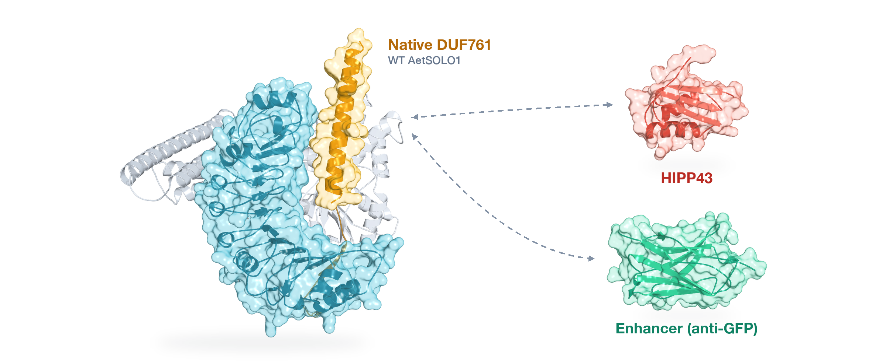

# SOLO1

Single-gene immune receptors confer made-to-order plant disease resistance.

<p align="center">
  <picture>
    <source media="(prefers-color-scheme: dark)" srcset="assets/solo1_banner_dark.png">
    <source media="(prefers-color-scheme: light)" srcset="assets/solo1_banner_light.png">
    
  </picture>
</p>

This repository contains the code and data needed to reproduce the
computational analyses and figures of the SOLO1 study. The study combines
AlphaFold 3 structural screening of plant NLR proteins carrying integrated
domains (NLR-IDs) with functional assays in *Nicotiana benthamiana* to identify
SOLO1, a conserved grass NLR clade whose members can trigger immune cell death
as single receptors. Replacing its native integrated domain with heterologous
ligand-binding modules yields single-gene receptors that confer
ligand-specific immunity and antiviral resistance.

> **Interactive 3D Atlas:** Explore the 296 ranked NLR-ID candidates (plus the NbNRC2a benchmark), their AlphaFold 3 hexamer models and PAE matrices, the NB-ARC phylogeny, and cell-death screening results directly in the browser at **[SOLO1 Structural Screening Atlas](https://yusugihara.github.io/SOLO1-atlas/)**.

## Repository layout

Each directory is a self-contained analysis with its own `README.md`,
`scripts/`, and `data/`. Steps are numbered `<directory>.<step>`, and each
script shares that number with the files it writes. Run every command from the
root of the repository.

| Directory | Analysis | Figures and tables |
| --- | --- | --- |
| [`01_nlr_id_dataset`](01_nlr_id_dataset) | Extract and filter CC-NLRs carrying candidate integrated domains from 180 annotated plant proteomes | Fig. 1A |
| [`02_af3_modeling`](02_af3_modeling) | Prepare non-redundant N-terminus-to-NB-ARC regions and AlphaFold 3 Server hexamer jobs | Fig. 1A |
| [`03_structural_metrics`](03_structural_metrics) | Score predicted hexamers on six structural metrics using [`SolNRCH_foldome`](https://github.com/amiralito/SolNRCH_foldome) | Table S1 |
| [`04_ranking`](04_ranking) | Rank candidates by composite structural score and generate ranking, PAE, and structure panels | Fig. 1B, Fig. 1C, Table S1 |
| [`05_candidate_nbarc_tree`](05_candidate_nbarc_tree) | Infer the NB-ARC phylogeny of the 296 modeled candidates and plot structural metric and screening tracks | Fig. 2A, Fig. 2B, Fig. S2 |
| [`06_plant_nlr_nbarc_tree`](06_plant_nlr_nbarc_tree) | Infer the NB-ARC phylogeny placing SOLO1 among monocot and reference plant NLRs | Fig. S4 |
| [`07_solo1_homologues`](07_solo1_homologues) | Characterize SOLO1 clade phylogeny, domain lengths, alignments, monomer PAE matrices, and the MADA motif | Fig. S5, Fig. S6, Fig. S9A |
| [`08_cell_death_assays`](08_cell_death_assays) | Analyze and plot cell-death scores from transient expression assays | Fig. 3B, Fig. S7, Tables S2–S5 |
| [`09_pvx_infection_assay`](09_pvx_infection_assay) | Analyze fluorescence measurements from the potato virus X (PVX) infection assay | Fig. 4C, Fig. 4D, Tables S6–S7 |

## Data sources

External datasets used in this study are listed below. All downstream analyses
can be reproduced directly from this repository, except for the steps marked
as requiring an external download:

| Dataset | Source | Availability / needed for |
| --- | --- | --- |
| NLRtracker annotations of 180 RefSeq plant proteomes (Toghani & Kamoun, 2024) | [doi:10.5281/zenodo.13627395](https://doi.org/10.5281/zenodo.13627395) | Download required for Step 1.1 (`01_nlr_id_dataset`); subset included for `06_plant_nlr_nbarc_tree` |
| RefPlantNLR curated reference set (Kourelis et al., 2021) | [doi:10.1371/journal.pbio.3001124](https://doi.org/10.1371/journal.pbio.3001124) | Included in `06_plant_nlr_nbarc_tree` |
| AlphaFold 3 structure predictions (891 hexamers + 5 SOLO1 monomers) | [doi:10.5281/zenodo.24540207](https://doi.org/10.5281/zenodo.24540207) | Download required for Steps 3.1, 4.3, and 7.12 (also browsable on the [SOLO1 Atlas](https://yusugihara.github.io/SOLO1-atlas/)) |

## Software

All command-line analyses run in the conda environment defined by
[`environment.yml`](environment.yml), except for AlphaFold 3 structure
prediction (`02_af3_modeling`, AlphaFold Server) and structural metric
scoring (`03_structural_metrics`, `SolNRCH_foldome`):

```bash
conda env create -f environment.yml
conda activate solo1
```

Step 5.4 was originally run with IQ-TREE 2.3.6 and Step 7.6 with IQ-TREE
3.0.1; [`environment.yml`](environment.yml) pins IQ-TREE 3.0.1.

| Tool | Version |
| --- | --- |
| [Python](https://www.python.org) | 3.10.12 |
| [NumPy](https://numpy.org) | 2.2.6 |
| [pandas](https://pandas.pydata.org) | 2.3.3 |
| [Matplotlib](https://matplotlib.org) | 3.10.9 |
| [SciPy](https://scipy.org) | 1.15.3 |
| [statsmodels](https://www.statsmodels.org) | 0.15.0 |
| [Biopython](https://biopython.org) | 1.88 |
| [R](https://www.r-project.org) | 4.5.3 |
| [ggtree](https://bioconductor.org/packages/ggtree/) | 4.0.5 |
| [ape](https://cran.r-project.org/package=ape) | 5.8.1 |
| [ggplot2](https://ggplot2.tidyverse.org) | 4.0.4 |
| [ggnewscale](https://eliocamp.github.io/ggnewscale/) | 0.5.2 |
| [patchwork](https://patchwork.data-imaginist.com) | 1.3.2 |
| [dplyr](https://dplyr.tidyverse.org) | 1.2.1 |
| [readr](https://readr.tidyverse.org) | 2.2.0 |
| [tibble](https://tibble.tidyverse.org) | 3.3.1 |
| [optparse](https://cran.r-project.org/package=optparse) | 1.8.2 |
| [svglite](https://svglite.r-lib.org) | 2.2.2 |
| [ragg](https://ragg.r-lib.org) | 1.5.2 |
| [systemfonts](https://systemfonts.r-lib.org) | 1.3.4 |
| [CD-HIT](https://sites.google.com/view/cd-hit) | 4.8.1 |
| [MAFFT](https://mafft.cbrc.jp/alignment/software/) | 7.526 |
| [FAMSA](https://github.com/refresh-bio/FAMSA) | 2.4.1 |
| [ClipKIT](https://jlsteenwyk.com/ClipKIT/) | 2.4.1 |
| [seqtk](https://github.com/lh3/seqtk) | 1.5-r133 |
| [IQ-TREE](http://www.iqtree.org) | 2.3.6 (Step 5.4), 3.0.1 (Step 7.6) |
| [VeryFastTree](https://github.com/citiususc/veryfasttree) | 4.0.5 |
| [TaxonKit](https://bioinf.shenwei.me/taxonkit/) | 0.20.0 |
| [`SolNRCH_foldome`](https://github.com/amiralito/SolNRCH_foldome) | [doi:10.64898/2026.05.03.722499](https://doi.org/10.64898/2026.05.03.722499) |
| [AlphaFold Server](https://alphafoldserver.com) | AlphaFold 3 |

## Citation

Azcue, J.M., Posbeyikian, A., Toghani, A., Chiang, B.-J., Youles, M.,
Lüdke, D., Xi, Y., Kamoun, S.\*, and Sugihara, Y.\*
Single-gene immune receptors confer made-to-order plant disease resistance.
*In preparation*.

\*Corresponding authors.
